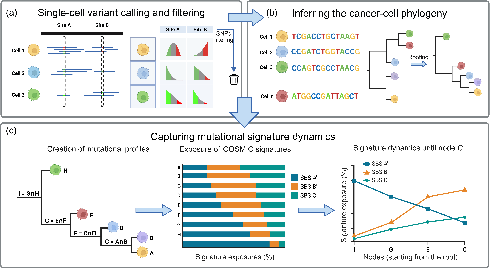

# **SigDyn**

**SigDyn: single-cell mutational signature dynamics**

SigDyn is a workflow designed to study mutational processes and their dynamics in tumors using single-cell RNA-seq data from one timepoint.
It integrates single-cell variant information, phylogenetic reconstruction, and mutational signature analysis to track how mutational processes evolve during tumor evolution.



---

## **Overview of the workflow**

SigDyn consists of 3 steps:

1. **Single-cell somatic mutation detection**
   Reads are aligned using CellRanger and genotype matrices are inferred using PhylinSic, followed by additional filtering of germline variants and artifacts.

2. **Tumor cell phylogeny inference**
   A phylogenetic tree is reconstructed from variant information using FastTree, followed by (optional) manual rooting to reflect tumor evolution.

3. **Mutational signature dynamics**
   Mutational signatures are assigned to single cells and inferred ancestral nodes, allowing visualization of how signature activities evolve along the tree.

---

## **Requirements**

### **Software**

* `snakemake ≥ 7`
* `conda` (or `mamba`)

### **Automatically managed via Conda**

All Python and tool dependencies are handled automatically using snakemake’s `--use-conda`, including:

* Python ≥ 3.10
* pandas, numpy, ete3
* FastTree
* SigProfilerAssignment
* SigProfilerMatrixGenerator

---

## **Running the workflow (quick start)**

#### 1. Alignment
* Align the raw single-cell sequence files (FASTQ) following a suitable pipeline for your input data.
    * For single-cell sequencing data acquired using 10x Genomics, CellRanger is available at https://www.10xgenomics.com/support/software/cell-ranger/latest/analysis.

#### 2. Variant calling
* Execute steps 1 to 8 ("_Prepare the reference genome_" to "_Call/impute genotypes_") of the PhylinSic workflow, available at https://github.com/U54Bioinformatics/PhylinSic_Project/tree/main.
* **Input:** BAM files obtained in step 1 above.
* **Output:** `genotypes.txt`, to be placed under `data/phylinsic` (a mock file is provided).

> A note at the end of this README describes some implementation choices used in our setup of the PhylinSic workflow to improve runtime and ensure compatibility with downstream SigDyn analyses.

#### 3. Variant filtering and tree inference
* Execute the following snakemake command using the pipeline under the root of this repository:
```bash
snakemake --use-conda --conda-frontend conda --cores 8 stage1_unrooted -p
```
* **Input:** `genotypes.txt` file under `data/phylinsic` and `pon.vcf`file containing the variants to filter (based on a panel of normals or a matched normal sample) under `resources/`. Note: in the paper, we used the panel of normals available at https://gatk.broadinstitute.org/hc/en-us/articles/360035890631-Panel-of-Normals-PON.
* **Output:** two files, `results/trees/cell_tree.unrooted` and `results/trees/root_cell.txt`.
* **This command will:** filter variants present in the `pon.vcf` file, convert genotypes to FASTA format, infer an unrooted phylogenetic tree, and suggest a root candidate cell.

#### 4. Tree rooting (optional)
* SigDyn intentionally pauses to allow for tree rooting.
    * To perform rooting: open the unrooted tree file `results/trees/cell_tree.unrooted` in FigTree (available at https://tree.bio.ed.ac.uk/software/figtree/), root the tree e.g. using the suggested root cell, and export in newick format to output file `results/trees/cell_tree.rooted`.
    * To skip rooting, simply rename the file `cell_tree.unrooted` to `cell_tree.rooted`.

#### 5. Mutational signature activity estimation
* Execute the following snakemake command using the pipeline under the root of this repository:
```bash
snakemake --use-conda --conda-frontend conda --cores 8 stage2_full
```
* **Input:** `cell_tree.rooted` file under `results/trees` and mutational signatures `COSMIC_v3.4_SBS_GRCh38.txt` file under `resources/`. The mutational signatures can be downloaded from https://cancer.sanger.ac.uk/signatures/downloads/.
* **Output:**
    * final signature activities for every cell and internal ancestor node: `exposures_active_signatures.txt` under `results/signatures/`
    * phylogenetic tree with labeled internal ancestor nodes: `cell_tree.rooted.named`
* **This will:** create genotypes for internal ancestor nodes, prepare VCF files, create mutational profiles and estimate COSMIC mutational signature activities for cells (leaves), identify active signatures (present in ≥10% of cells), re-estimate signature activities using only active signatures for both cells (leaves) and internal ancestor nodes.

---
## Reproducing the figures in the paper
* All scripts needed to reproduce the figures in the paper are available under `Case_studies/`.

---

#### **Final note regarding PhylinSic adjustments**
  
* For the PhylinSic pipeline, some adjustments were made to both improve reliability of smoothing and efficiency of running the pipeline by changing the rules "select_neighbors2", "calc_neighbor_scores1" and "calc_neighbor_scores2" (the updated rules are bellow and can be updated in the snakefile of PhylinSic before running it) and updating the script "select_neighbors1" to the one under PhylinSic_adjusted_scripts/. 
* We advise users to do the same.

```python
rule select_neighbors2:
    input:
        [opj(GENOTYPE_DIR, "knn.neighbors.%s.txt" % batch)
         for batch in KNN_BATCHES],
    output:
        opj(GENOTYPE_DIR, "knn.neighbors.txt"),
    params:
        K=TERNARY_K,
    script:
        "scripts/select_neighbors1.py"

rule calc_neighbor_scores1:
    input:
        opj(FILTER_DIR, "ref_count.features.txt"),
        opj(FILTER_DIR, "alt_count.features.txt"),
    output:
        opj(FILTER_DIR, "knn.neighbors.{batch,[A-Za-z0-9_-]+}.txt"),
    params:
        K=TERNARY_K,
        num_samples=TERNARY_SAMPLES,
        rng_seed=PHYLO_RNG_SEED,
        start=lambda wildcards: int(wildcards.batch) + 1,
        skip=len(KNN_BATCHES),
        num_cores=workflow.cores,
    script:
        "scripts/calc_neighbor_scores1.R"

rule calc_neighbor_scores2:
    input:
        opj(GENOTYPE_DIR, "ref_count.features.txt"),
        opj(GENOTYPE_DIR, "alt_count.features.txt"),
    output:
        opj(GENOTYPE_DIR, "knn.neighbors.{batch,[A-Za-z0-9_-]+}.txt"),
    params:
        K=TERNARY_K,
        num_samples=TERNARY_SAMPLES,
        rng_seed=PHYLO_RNG_SEED,
        start=lambda wildcards: int(wildcards.batch) + 1,
        skip=len(KNN_BATCHES),
        num_cores=workflow.cores,
    script:
        "scripts/calc_neighbor_scores1.R"
```
